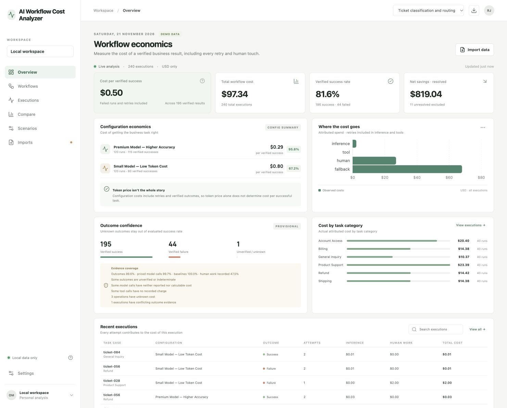
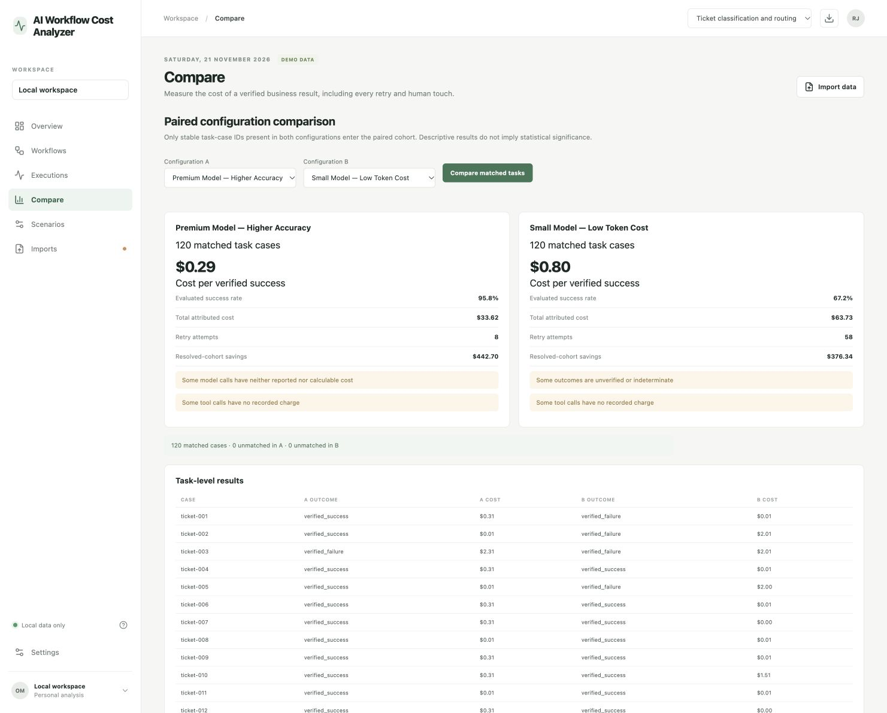

# AI Workflow Cost Analyzer

**Measure what an AI workflow costs to actually succeed.**

Inference spend alone does not describe the economics of an AI workflow. AI Workflow Cost Analyzer combines model and tool charges, retries, human review and fallback work, explicit business outcome evidence, and human-only baselines to estimate the cost of verified results.

AI Workflow Cost Analyzer is an independent local economics analysis layer. It is not a chat app, framework wrapper, observability replacement, or financial forecasting system. A completed model response is never treated as business success without an explicit outcome label.



The dashboard above uses the bundled synthetic examples. It includes a support-routing comparison with 120 matched task cases and an invoice-processing workflow. Values are illustrative and do not represent provider prices or a quality benchmark.

## Screenshots

### Paired configuration comparison

The comparison uses only task cases present in both configurations. In the seeded support-routing example, the higher-accuracy configuration has a lower cost per verified success and a higher evaluated success rate; results are descriptive, not a claim of statistical significance.



## Current capabilities

- Local DuckDB persistence, application-level relationship checks, serialized writes, and atomic imports
- Decimal calculations for inference and labor costs, effective-dated USD model pricing, and retained pricing provenance
- Explicit task cases, logical attempts, executions, model/tool calls, human work, outcome evidence, experiments, baselines, and import receipts
- Native versioned JSON/JSONL and typed CSV import, preview, dry run, row-aware errors, and checksum idempotency
- A documented OTLP/JSON trace subset with explicit trace-to-task mapping; imported telemetry remains unverified
- Workflow and configuration creation, manual verification, execution details, data-quality coverage, paired comparison, scenario analysis, and report endpoints
- Responsive dashboard, execution explorer, configuration comparison, scenario, import, workflow, and assumptions screens
- Synthetic support-routing and invoice workflows with missing-data and conflicting-evidence examples

## Quickstart

Requirements: Python 3.12+, Node.js 20.19+ (Node 22 recommended), `uv`, and `pnpm`.

```bash
make setup
make seed
make dev
```

Open <http://127.0.0.1:5173>. The API and OpenAPI docs are at <http://127.0.0.1:8000/docs>. `make dev` starts both local processes; Ctrl+C stops them. For one command that also installs dependencies and seeds the examples, use `make demo`.

The default database path is `apps/api/data/ai-workflow-cost-analyzer.duckdb` when started with the supplied commands. Set `AI_WORKFLOW_COST_ANALYZER_DB` to change it. `AI_WORKFLOW_COST_ANALYZER_CORS_ORIGINS` accepts comma-separated trusted browser origins. If the default ports are occupied, set `AI_WORKFLOW_COST_ANALYZER_API_PORT` and `AI_WORKFLOW_COST_ANALYZER_WEB_PORT` before `make dev`.

## Synthetic examples

`make seed` generates 120 stable fictional support tickets and evaluates each against a small, retry-prone configuration and a higher-accuracy configuration. The fixture includes tool costs, retries, review, correction, fallback labor, explicit evidence, one unverified outcome, missing model/tool prices, and contradictory evidence. A separate invoice-processing example covers totals, vendor identifiers, field validation, correction/fallback economics, and baselines. The generator uses a fixed seed; all model identifiers and prices are illustrative, not provider quotes or benchmark claims.

## Economics

Cost per verified success divides total selected-cohort spend, including failed and retried work, by verified successful executions. With no verified successes it is unavailable. Unknown outcomes remain visible; evaluated success rate uses verified successes plus verified failures. Human fallback is included in resolved-task costs. Unresolved tasks are excluded from resolved-cohort savings. If resolved tasks lack baselines, savings are unavailable instead of assuming a zero baseline. Intermediate calculations use `Decimal`; API amounts retain eight decimal places where applicable and the dashboard rounds money to cents.

See [economics methodology](docs/economics-methodology.md) for formulas, attribution rules, and limits.

## Import formats

Native imports are UTF-8 JSON envelopes (`{"schema_version":"1.0","records":[...]}`) or JSONL. CSV uses a `record_type` column for mixed event types; the execution template may omit `record_type`. OTLP/JSON import requires an explicit workflow, configuration, and trace-to-task-case mapping. Import limits are 10 MB and 50,000 events/spans. Imports validate relationships, commit atomically, store failed-import messages, and skip completed files with the same checksum.

See [import formats](docs/import-formats.md) and [OTLP compatibility](docs/otel-compatibility.md). Example CSV templates are in `examples/templates/`.

## API

Stable routes are available under `/api/v1`; `/api` is also used by the bundled client. Useful routes:

- `GET /api/v1/analytics/overview?workflow_id=...`
- `GET /api/v1/analytics/data-quality?workflow_id=...`
- `GET /api/v1/executions?search=...&limit=...&offset=...`
- `GET /api/v1/executions/{id}` and `POST /api/v1/verifications/{id}`
- `POST /api/v1/comparisons` and `POST /api/v1/scenarios/evaluate`
- `POST /api/v1/imports/preview`, `POST /api/v1/imports`, and `GET /api/v1/imports`
- `GET /api/reports/workflow.json`, `/api/reports/workflow.csv`, and `/api/reports/workflow.html`

Interactive OpenAPI documentation is served at `/docs`.

## Development

```bash
make setup   # locked Python and pnpm dependencies
make seed    # deterministic sample data
make dev     # API and frontend on loopback
make test    # backend and frontend tests
make lint    # Ruff checks and formatting checks
make build   # production frontend build
```

Backend tests include accounting, transactional import, idempotency, API workflows, CSV validation, OTLP mapping, pricing, verification, scenarios, and reports. Frontend tests cover money and percentage formatting. CI runs these checks without secrets.

## Architecture and security

FastAPI delivers the API, DuckDB stores normalized data, and core calculations live outside route handlers. The application supports one backend process with serialized writes. Do not run multiple API workers over one database file. See [architecture](docs/architecture.md), [data model](docs/data-model.md), and [security](docs/security.md).

The app binds to loopback by default, has no authentication, and is intended for trusted local use. Do not expose it publicly without authentication, authorization, TLS, and storage protections. No user data is sent to AI providers and no external telemetry is configured.

## Known limitations and next work

- USD is the only supported aggregation currency; foreign currency events are rejected where currency is specified.
- Statistical bootstrap intervals, full OTLP convention-version support, custom CSV field remapping, advanced comparison experiments, and a provider marketplace are outside the MVP.
- Scenarios hold measured outcomes/task mix fixed and apply the displayed assumptions; they do not predict model behavior.
- The current sample is synthetic and intended to demonstrate the analysis flow, not to validate real task quality.
- The production build currently emits a large JavaScript chunk warning; the build succeeds. Hosted CI was not run as part of this local verification.

See [contributing](CONTRIBUTING.md), [security policy](SECURITY.md), and [MIT license](LICENSE).

## License & Custom Work

[](mailto:work@withrana.com) [](https://www.linkedin.com/in/workwithrana)
[](https://www.upwork.com/freelancers/~01bbcf6edb91a8df5f)
[](https://contra.com/ranajahanzaib/)

**License:** MIT. Free for personal and commercial use.

**Author:** Rana Jahanzaib

**Need this built for your stack?** Email me what you're working on: work@withrana.com
